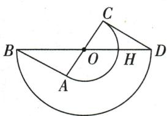

<!-- question-source:start -->
3[2024 河北保定期末, 中]如图, 有两个同圆心半圆, 为半圆 AC 和半圆 BD, 其中半圆 BD 固定不动, 半圆 AC 绕圆心 O 沿逆时针方向转动一周, 连接 AB, CD, 转动过程中, 半圆 AC 与线段 BD 的交点记为点 H, 若 $AO = \frac{1}{2} BO = 4$ .

(1) 求证: AB = CD;

(2) 在转动过程中, 求 $\triangle ABO$ 面积的最大值及此时线段 CD 的长;

(3) 当 AB 与半圆 AC 相切时, 求 $\widehat{AH}$ 的长.

<!-- question-source:end -->

![[Q00106970A1]]
