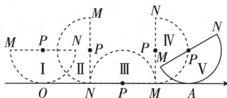

<!-- question-source:start -->
4 核心素养几何直观 [2025 辽宁鞍山质检, 难] 如图, 数轴的原点为 O, 有一个直径 MN=4 的半圆形纸片, 其圆心为点 P, 从初始阶段 I 位置开始, 在无滑动的情况下沿数轴向右翻滚至位置 V. 其中位置 I 中的 MN 平行于数轴, 且半圆 P 与数轴相切于原点 O; 位置 II 和位置 IV 中的 MN 垂直于数轴; 位置 III 中的 MN 在数轴上; 位置 V 中的点 N 到数轴的距离为 3, 且半圆 P 与数轴相切于点 A. 解答下列问题:

(1) 位置 I 中的 MN 与数轴之间的距离为 \_\_\_\_，位置 II 中的半圆 P 与数轴的位置关系是 \_\_\_\_；

(2) 求位置Ⅲ中的圆心 P 在数轴上表示的数；

(3) 半圆 P 从位置Ⅲ翻滚到位置Ⅳ时, 求点 N 所经过路径长及该纸片所扫过的图形的面积;
(4) 求 OA 的长. (结果保留 $\pi$ )

<!-- question-source:end -->

![[Q00106971A1]]
