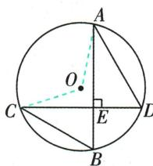

> [!success]- 必刷题
>
> > [!success] **【答案】** C
>
> > [!note]- **【解析】**
> > 连接 OA, OC, 如图. ∵ AB ⊥ CD, ∠BAD = 30°, ∴ ∠ADC = 180° - 90° - 30° = 60°, ∴ ∠AOC = 2∠ADC = 120°. ∵ ⊙O 的半
> >
> > 
> >
> > 径为 $6, \therefore \widehat{AC}$ 的长为 $\frac{120\pi \times 6}{180} = 4\pi$ .
> >
> > 故选 **C**.
