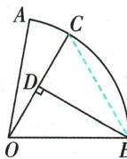

> [!success]- 必刷题
>
> > [!success] **【答案】** B
>
> > [!note]- **【解析】**
> > 如图, 连接 BC. ∵ OD = DC, BD ⊥
> >
> > $OC, \therefore BC = OB. \because OB = OC,$ $\therefore \triangle OBC$ 是等边三角形， $\therefore \angle BOC = 60^{\circ}. \because \angle AOB = 80^{\circ},$ $\therefore \angle AOC = 20^{\circ}. \because OA = 3, \therefore \widehat{AC}$ 的长为 $\frac{20\pi \times 3}{180} = \frac{\pi}{3}$ . 故选B.
> >
> > 
