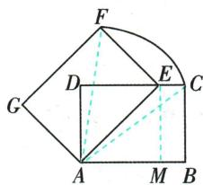

> [!success]- 必刷题
>
> > [!success] **【答案】** $\frac{3\pi}{4}$
>
> > [!note]- **【解析】**
> > 如图, 连接 AC, AF, 过点 E 作 EM⊥AB 于 M, 则 EM = CB = $\sqrt{3}$ . 由旋转的性质可知, AB = AE = $\sqrt{6}$ , AC = AF. 在 Rt $\triangle ABC$ 中， $AC = \sqrt{(\sqrt{6})^2 + (\sqrt{3})^2} = 3.$ 在 $\mathbf{Rt}\triangle AEM$ 中， $AM = \sqrt{(\sqrt{6})^2 - (\sqrt{3})^2} = \sqrt{3},\therefore AM = EM,$
> >
> > $\therefore \angle EAM = 45^{\circ}$ . 由旋转可得, $\angle FAC = \angle EAM = 45^{\circ}$ , $\therefore \widehat{CF}$ 的长为 $\frac{45\pi \cdot 3}{180} = \frac{3\pi}{4}$ . 故答案为 $\frac{3\pi}{4}$ .
> >
> > 
> >
> > 关键点拨
> > 利用割补法将阴影部分分成三部分，即 $S_{\text{阴影}} = S_{\text{扇形}AGF} + S_{\triangle AEG} + (S_{\text{扇形}BAE} - S_{\triangle ABE})$ ，然后分别求出每部分的面积即可.
