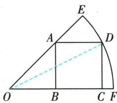

> [!success]- 必刷题
>
> > [!success] **【答案】** $\frac{5}{8}\pi$
>
> > [!note]- **【解析】**
> > 如图所示，连接 $OD$ . $\because \angle AOB = \angle EOF = 45^{\circ}$ , 四边形 $ABCD$ 是正方形, $\therefore AB = OB = BC = CD = 1, \therefore OC =$
> >
> > 
