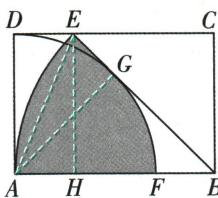

> [!success]- 必刷题
>
> > [!success] **【答案】** $\frac{3}{2}\pi - 2$
>
> > [!note]- **【解析】**
> > 设 $BE$ 与扇形 $ADF$ 的切点为 $G$ , 如图, 连接 $AE, AG$ , 则 $AG \perp BE$ , 过点 $E$ 作 $EH \perp AB$ ,
> >
> > 
> >
> > 交 $AB$ 于点 $H$ . $\because$ 四边形 $ABCD$ 是矩形, $\therefore BC = AD = 2, CD = AB = 2\sqrt{2}$ . 由题意可得, $BE = AB = 2\sqrt{2}$ . 在 Rt $\triangle BCE$ 中, 由勾股定理, 得 $CE = \sqrt{(2\sqrt{2})^2 - 2^2} = 2$ , $\therefore DE = CD - CE = 2\sqrt{2} - 2$ , $CE = BC$ , $\therefore \angle CBE = 45^\circ$ , $\therefore \angle ABE = 45^\circ$ , 即扇形 $BAE$ 的圆心角为 $45^\circ$ . 在 Rt $\triangle DAE$ 和 Rt $\triangle GAE$ 中, $\left\{ \begin{array}{l} AE = AE, \\ DA = GA, \end{array} \right.$ $\therefore$ Rt $\triangle DAE \cong$ Rt $\triangle GAE$ (HL), $\therefore EG = DE = 2\sqrt{2} - 2$ , $\therefore BG = 2\sqrt{2} - (2\sqrt{2} - 2) = 2$ , $\therefore \angle GAF = \angle ABE = 45^\circ$ , 即扇形 $AGF$ 的圆心角为 $45^\circ$ , $\therefore S_{\text{阴影}} = S_{\text{扇形} AGF} + S_{\triangle AEG} + (S_{\text{扇形} BAE} - S_{\triangle ABE}) = \frac{45 \times 2^2\pi}{360} + \frac{1}{2} AG \cdot EG + \left( \frac{45 \cdot (2\sqrt{2})^2\pi}{360} - \frac{1}{2} AB \cdot EH \right) = \frac{1}{2}\pi + \frac{1}{2} \times 2 \times (2\sqrt{2} - 2) + \left( \pi - \frac{1}{2} \times 2\sqrt{2} \times 2 \right) = \frac{1}{2}\pi + 2\sqrt{2} - 2 + \pi - 2\sqrt{2} = \frac{3}{2}\pi - 2$ . 故答案为 $\frac{3}{2}\pi - 2$ .
