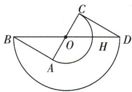
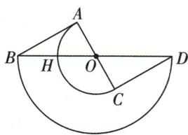

> [!success]- 必刷题
>
> > [!success] **【答案】** （1）
>
> > [!note]- **【解析】**
> > 【证明】在 $\triangle AOB$ 和 $\triangle COD$ 中， $\left\{ \begin{array}{l} OB = OD, \\ \angle AOB = \angle COD, \therefore \triangle AOB \cong \triangle COD(\text { SAS }) , \\ OA = OC, \end{array} \right.$ $\therefore AB = CD.$ 【解】(2) $\because AO = OC = \frac{1}{2} BO = 4, \therefore BO = OD = 8.$ 当 $AC \perp BD$ 时， $\triangle AOB$ 的面积最大，最大值为 $\frac{1}{2} OA \cdot OB = \frac{1}{2} \times 4 \times 8 = 16.$ $\because OC = 4, O D = 8, \angle COD = 90^{\circ}, \therefore C D = \sqrt{OC^{2} + OD^{2}} = \sqrt{4^{2} + 8^{2}} = 4\sqrt{5}.$ (3) 当 $AB$ 与半圆 $AC$ 相切时， $OA \perp AB, \therefore \angle OAB = 90^{\circ}$ ，分两种情况：如图(1)，当点 $A$ 在 $OB$ 的下方时， $\because OB = 2OA, \therefore \angle ABO = 30^{\circ}, \therefore \angle AOB = 90^{\circ} - 30^{\circ} = 60^{\circ}, \therefore \angle AOH = 180^{\circ} - 60^{\circ} = 120^{\circ}, \therefore \widehat{AH}$ 的长为 $\frac{120\pi \times 4}{180} = \frac{8\pi}{3}$ ；如图(2)，当点 $A$ 在 $OB$ 的上方时，同理可得$\widehat{AH}$ 的长为 $\frac{4\pi}{3}$ . 综上所述, $\widehat{AH}$ 的长为 $\frac{4\pi}{3}$ 或 $\frac{8\pi}{3}$ .
> >
> > 
> > 图(1)
> >
> > 
> > 图(2)
> >
> > ## 刷素养·
