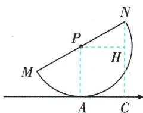

> [!success]- 必刷题
>
> > [!success] **【答案】** 2, 相切
>
> > [!note]- **【解析】**
> > 【解】(1)∵ 半圆 P 的直径 MN=4, ∴ 半圆 P 的半径为 2. ∵ 位置 I 中半圆 P 与数轴相切于原点, MN 平行于数轴, ∴ 位置 I 中的 MN 与数轴之间的距离为 2. ∵ 位置 II 中的 MN 垂直于数轴, ∴ 位置 II 中的半圆 P 与数轴的位置关系是相切.
> > 故答案为2, 相切.
> >
> > (2)位置I中 $\widehat{ON}$ 的长与数轴上线段 $ON$ 的长相等. $\because l_{\widehat{ON}} = \frac{90\cdot\pi\cdot 2}{180} = \pi$ ，位置Ⅲ中 $NP = 2$ ∴位置Ⅲ中的圆心 $P$ 在数轴上表示的数为 $\pi +2.$
> >
> > (3)由弧长公式可得,点 N 所经过路径长为 $\frac{90\pi \cdot 4}{180} = 2\pi.$ $\because S_{半圆}=\frac{180\pi\cdot2^{2}}{360}=2\pi,S_{扇形}=\frac{90\pi\cdot4^{2}}{360}=4\pi,$ ∴该纸片所扫过的图形的面积为 $2\pi+4\pi=6\pi$ .
> >
> > 掌握弧长和扇形面积的计算公式是解题关键.
> >
> > (4)如图,作 NC 垂直数轴于点 C, 作 $PH \perp NC$ 于点 H, 连接 PA, 则 NC=3, 四边形 PHCA 为矩形.
> >
> > 
> >
> > 在 Rt△NPH 中，PN=2, NH=NC-HC=NC-PA=1，易得 $\angle NPH=30^{\circ}$ ，∴ $\angle MPA=60^{\circ}$ ，
> > ∴ $l_{\widehat{MA}}=\frac{60\pi\times2}{180}=\frac{2\pi}{3}$ ，∴ OA 的长为 $\pi+4+\frac{2}{3}\pi=\frac{5}{3}\pi+4.$
