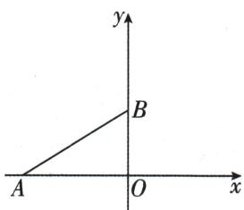

<!-- question-source:start -->
6[2025 江苏南京质检]在平面直角坐标系 $xOy$ 中, 点 $A, B$ 分别在 $x$ 轴负半轴、 $y$ 轴正半轴上 $(OA > OB)$ , $C(a, -a)$ ( $a$ 为常数), 以 $C$ 为圆心、适当的长度为半径作 $\odot C$ , 使点 $A, B$ 在 $\odot C$ 上.

(1)请用无刻度的直尺和圆规作出 $\odot C$ .（保留作图痕迹,不写作法）

(2) 若 OA=8, OB=6, 直线 $y=x+b$ 与 $\odot C$ 有且只有一个公共点, 则 b= \_\_\_\_.
<!-- question-source:end -->

![[Q00106899A1]]
