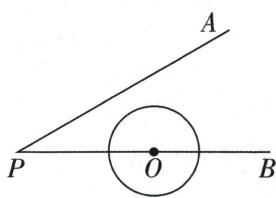

<!-- question-source:start -->
7 如图, 已知 $\angle APB = 30^{\circ}, OP = 3 \, cm, \odot O$ 的半径为 1 cm, 若圆心 O 沿着 BP 方向在直线 BP 上移动.

(1) 当圆心 O 移动的距离为 1 cm 时, $\odot O$ 与直线 PA 的位置关系是什么?

(2) 若圆心 O 的移动距离是 d cm, 当 $\odot O$ 与直线 PA 相交时, d 的取值范围是什么?

<!-- question-source:end -->

![[Q00106900A1]]
