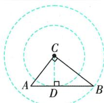

> [!success]- 必刷题
>
> > [!success] **【答案】** $r=\frac{12}{5}$ 或 $3<r\leqslant4
>
> > [!note]- **【解析】**
> > 如图, 过点 C 作 $CD \perp AB$ 于点 D. ∵ 在 Rt△ABC 中, $\angle ACB = 90^{\circ}$ , AC = 3, BC = 4, ∴ AB = $\sqrt{AC^{2} + BC^{2}} = \sqrt{3^{2} + 4^{2}} = 5$ .
> >
> > ## 思路分析
> >
> > 
> >
> > 根据直线与圆的位置关系得出相切时只有一个公共点，再结合图形得出另一种只有一个公共点的情况，即可得出答案.
> >
> > $\because S_{Rt\triangle ABC}=\frac{1}{2}AC\cdot BC=\frac{1}{2}AB\cdot CD,\therefore CD=\frac{AC\cdot BC}{AB}=\frac{3\times4}{5}=\frac{12}{5}.$ 当 $\odot C$ 和 AB 所在直线相切时， $\odot C$ 的半径为 $\frac{12}{5}$ ; 当 $\odot C$ 和 AB 所在直线相交，且只有一个公共点在斜边上时， $AC<r\leqslant BC$ ，即 $3<r\leqslant4.$ 综上，r 的取值范围是 $r=\frac{12}{5}$ 或 $3<r\leqslant4.$ 故答案为 $r=\frac{12}{5}$ 或 $3<r\leqslant4.$
> >
> > 易错警示
> > 在利用 d 与 r 的数量关系判定直线与圆的位置关系时，要正确理解 d 的意义，从而避免出现错误.
