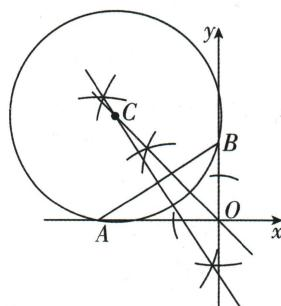

> [!success]- 必刷题
>
> > [!success] **【答案】** 4 或 24
>
> > [!note]- **【解析】**
> > 【解】(1) 如图, $\odot C$ 即为所作.
> > (2) 当直线 $y = x + b$ 与 $\odot C$ 有且只有一个公共点时, 设公共点为点 T, 连接 CA, CB, CT, 则易知 CT 和直线 $y = x + b$ 垂直, 且
> >
> > 
> >
> > $CT = AC = CB.\because C(a, - a),\therefore$ 点 $C$ 在直线 $y = -x$ 上，∴点 $T$ 是直线 $y = -x$ 和直线 $y = x + b$ 的交点.联立得 $\left\{ \begin{array}{ll}y = -x,\\ y = x + b, \end{array} \right.$ 解得 $\left\{ \begin{array}{ll}x = -\frac{1}{2} b,\\ y = \frac{1}{2} b, \end{array} \right.\therefore T\left(-\frac{1}{2} b,\frac{1}{2} b\right).$
> >
> > $\because OA = 8, OB = 6, \therefore A(-8,0), B(0,6)$ . 由 $CT = AC = CB$ 得， $\left(a + \frac{1}{2} b\right)^2 + \left(-a - \frac{1}{2} b\right)^2 = (a + 8)^2 + (-a)^2 = a^2 + (-a - 6)^2$ ，解得 $b = 4$ 或 24. 故答案为 4 或 24.
