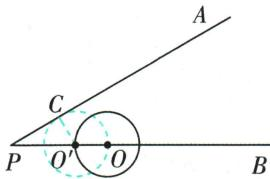
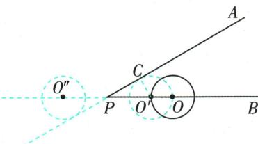

> [!success]- 必刷题
>
> > [!success] **【答案】** 详见解析
>
> > [!note]- **【解析】**
> > 【解】(1)如图(1)，当圆心O向左移动1cm时， $PO'=PO-O'O=3-1=2(\text{cm})$ ，作 $O'C\perp PA$ 于点C.∵ $\angle P=30^{\circ}$ ，
> >
> > 于点 C. $\because \angle P = 30^{\circ}$ , $\therefore O^{\prime}C=\frac{1}{2}PO^{\prime}=$ 1 cm. $\because \odot O$ 的半径为 1 cm, $\therefore O^{\prime}C$ 为 $\odot O$ 的半径, $\therefore \odot O$
> >
> > 
> > 图(1)
> >
> > 与直线 $PA$ 的位置关系是相切. (2)如图(2)，当圆心 $O$ 由 $O'$ 向左继续移动时， $PA$ 与 $\odot O$ 相交；当圆心 $O$ 移动到点 $O''$ 时， $PA$ 与 $\odot O$ 相切，此时 $O''P = PO' = 2\mathrm{cm}$ . $\because OP = 3\mathrm{cm}, \therefore OO'' = OP + O''P = 3 + 2 = 5(\mathrm{cm})$ ， $\therefore$ 当 $\odot O$ 与直线 $PA$ 相交时，圆心 $O$ 移动的距离 $d$ 的取值范围为 $1 < d < 5$ .
> >
> > 
> > 图(2)
> >
> > ## 刷易错·
