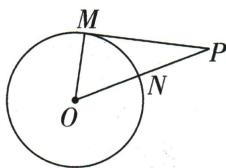

<!-- question-source:start -->
1[2024 河北石家庄晋州期末]如图所示, $\triangle POM$ 中,点M在 $\odot O$ 上,点P在 $\odot O$ 外,OP交 $\odot O$ 于点N,以下条件不能判定PM是 $\odot O$ 的切线的是()

A. $\angle O + \angle P = 90^{\circ}$ B. $\angle O + \angle P = \angle OMP$ C. $OM^{2} + PM^{2} = OP^{2}$ D.点 $N$ 是 $OP$ 的中点

<!-- question-source:end -->

![[Q00106902A1]]
