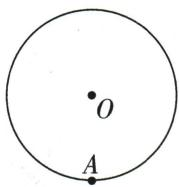
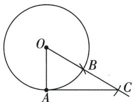

<!-- question-source:start -->
2[2025 天津南开区期中]如图(1)， $\odot O$ 的半径为 $3, A$ 为 $\odot O$ 上一点. 如图(2)所示，按以下步骤作图：

①连接 $OA$ ;

②以点 A 为圆心,3 为半径作弧,交 $\odot O$ 于点 B;
③在射线 OB 上截取 BC = OB;

④连接 $AC$ .

则下列说法中错误的是 （）

图(1)    图(2)
A. $\angle AOB = 60^{\circ}$ B. AC 为 $\odot O$ 的切线
C. AC = 6 D. $\angle ACO = 30^{\circ}$
<!-- question-source:end -->

![[Q00106903A1]]
