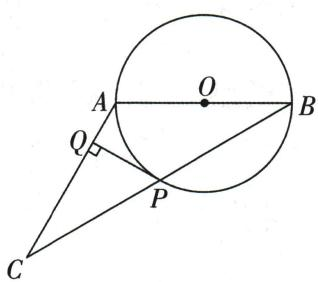

<!-- question-source:start -->
4[2025 河南郑州期中]如图, $\odot O$ 的直径 $AB = 10$ , $\angle ABC = 30^{\circ}$ , $BC$ 交 $\odot O$ 于 $P$ , $P$ 是 $BC$ 的中点.

(1) 求 BC 的长;

(2) 过点 P 作 $PQ \perp AC$ ，垂足为 Q，求证：PQ 是

$\odot O$ 的切线.

<!-- question-source:end -->

![[Q00106905A1]]
