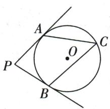
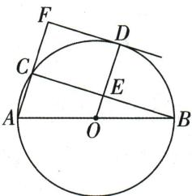

<!-- question-source:start -->
5[2024 湖南长沙期末]如图, $PA, PB$ 分别与 $\odot O$ 相切于 $A, B$ 两点, $\angle C = 50^{\circ}$ , 则 $\angle P =$ ( )
A. $50^{\circ}$ B. $100^{\circ}$ C. $130^{\circ}$ D. $80^{\circ}$

(第5题图)
(第6题图)
<!-- question-source:end -->

![[Q00106906A1]]
