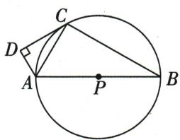

<!-- question-source:start -->
7[2025 江苏南京校级质检]如图,已知 AB 是 $\odot P$ 的直径,点 C 在 $\odot P$ 上,D 为 $\odot P$ 外一点,且 $\angle ADC = 90^{\circ}$ , CD 为 $\odot P$ 的切线.

(1) 若 $\angle B = 30^{\circ}, AC = 2$ , 求 $\odot P$ 的半径.

(2) 求证: $2 \angle B + \angle DAB = 180^{\circ}$ .

<!-- question-source:end -->

![[Q00106908A1]]
