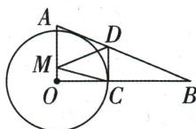

<!-- question-source:start -->
3[2024 湖北荆州松滋期末, 较难] 如图, 在 $\triangle AOB$ 中, $\angle AOB = 90^{\circ}, OB = 3$ , 半径为 1 的 $\odot O$ 与 $OB$ 交于点 $C$ , 且 $AB$ 与 $\odot O$ 相切, 过点 $C$ 作 $CD \perp OB$ 交 $AB$ 于点 $D$ , 点 $M$ 是边 $OA$ 上的动点, 则 $\triangle MCD$ 周长的最小值为 ( )

A. $2\sqrt{2}$ B. $\frac{\sqrt{6} + \sqrt{2}}{2}$ C. $\sqrt{2} +\frac{5}{3}$ D. $\frac{5\sqrt{2}}{3}$
<!-- question-source:end -->

![[Q00106911A1]]
