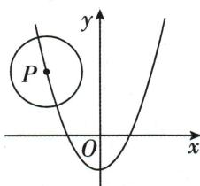

<!-- question-source:start -->
4[2024 山东日照期末, 中]如图, 已知 $\odot P$ 的半径为 1 , 圆心 $P$ 在抛物线 $y = \frac{1}{2} x^2 - 1$ 上运动, 当 $\odot P$ 与 $x$ 轴相切时, 所有符合条件的点 $P$ 的坐标为 \_\_\_\_.

<!-- question-source:end -->

![[Q00106912A1]]
