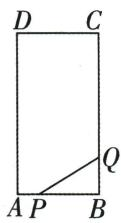
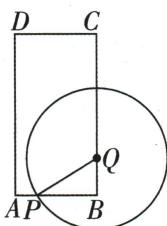
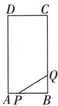
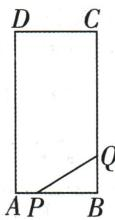

<!-- question-source:start -->
5 思想方法 数形结合 [2025 江苏无锡质检, 较难] 在矩形 $ABCD$ 中, $AB = 6 \mathrm{~cm}, BC = 12 \mathrm{~cm}$ , 点 $P$ 从点 $A$ 出发, 沿 $AB$ 边向点 $B$ 以每秒 $1 \mathrm{~cm}$ 的速度运动, 同时点 $Q$ 从点 $B$ 出发沿 $BC$ 边向点 $C$ 以每秒 $2 \mathrm{~cm}$ 的速度运动, $P, Q$ 两点在分别到达 $B, C$ 两点后停止运动. 设两点运动的时间为 $t$ 秒 $(t \geqslant 0)$ , 回答下列问题: (1) 如图 (1), 当 $t$ 为何值时, $\triangle PBQ$ 的面积等于 $8 \mathrm{~cm}^{2}$ ? (2) 如图 (2), 以 $Q$ 为圆心, $PQ$ 长为半径作 $\odot Q$ . ① 在运动过程中, 是否存在这样的 $t$ , 使 $\odot Q$ 正好与矩形 $ABCD$ 的一边相切? 若存在, 求出 $t$ 的值; 若不存在, 请说明理由. ② 若 $\odot Q$ 与矩形 $ABCD$ 有 4 个公共点, 请直接写出 $t$ 的取值范围.

图(1)

图(2)

备用图(1)

备用图(2)
<!-- question-source:end -->

![[Q00106913A1]]
