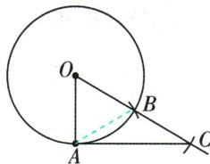

> [!success]- 必刷题
>
> > [!success] **【答案】** C
>
> > [!note]- **【解析】**
> > 连接 $AB$ , 如图. 由题意得, $OA =$
> >
> > $OB = AB = 3, \therefore \triangle AOB$ 为等边三角形， $\therefore \angle AOB = 60^{\circ}$ ，故A选项正确，不符合题意。 $\because \triangle AOB$ 为等边三角形， $\therefore \angle ABO =$
> >
> > 
> >
> > $\angle OAB = 60^{\circ}, \therefore \angle C + \angle BAC = 60^{\circ}.\because BC = OB,$ $\therefore BC = AB, \therefore \angle ACO = \angle BAC = 30^{\circ}, \therefore \angle OAC =$ $\angle OAB + \angle BAC = 90^{\circ}.\because OA$ 为 $\odot O$ 半径，∴ $AC$ 为 $\odot O$ 的切线，故B，D选项正确，不符合题意. $\because BC = OB = 3, \therefore OC = 6.$ 在Rt△AOC中，由勾股定理得， $AC = \sqrt{OC^2 - OA^2} = \sqrt{6^2 - 3^2} =$ $3\sqrt{3}$ ，故C选项不正确，符合题意.
> >
> > 故选 **C**.
