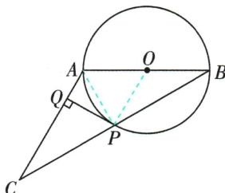

> [!success]- 必刷题
>
> > [!success] **【答案】** BC
>
> > [!note]- **【解析】**
> > 
> > 【证明】连接 $OP$ , 如图. $\because PQ \perp AC$ , $\therefore \angle PQC = 90^\circ$ . $\because P$ 是 $BC$ 的中点, $O$ 是 $AB$ 的中点, $\therefore OP$ 是 $\triangle BAC$ 的中位线, $\therefore OP \parallel AC$ , $\therefore \angle OPQ = \angle PQC = 90^\circ$ . $\because OP$ 是 $\odot O$ 的半径, $\therefore PQ$ 是 $\odot O$ 的切线.
