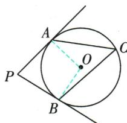

> [!success]- 必刷题
>
> > [!success] **【答案】** D
>
> > [!note]- **【解析】**
> > 如图, 连接 OA, OB. ∵ 直线 PA, PB 分别与 ⊙O 相切于点 A, B, ∴ OA⊥PA, OB⊥PB. ∵ ∠C=50°, C 是 ⊙O 上一点, ∴ ∠AOB=100°, ∴ 90°-100°=80°. 故选 D.
> >
> > 
> >
> > 一点, $\therefore \angle AOB = 100^{\circ}, \therefore \angle P = 360^{\circ} - 90^{\circ} - 90^{\circ} - 100^{\circ} = 80^{\circ}$ . 故选 D.
> >
> > 思路分析
> > 连接 OA, OB，
> > 先根据切线的
> > 性质得到 $\angle OAP = \angle OBP = 90^{\circ}$ ，再根据圆周角定理得到 $\angle AOB = 100^{\circ}$ 然后利用四边形的内角和为360°可计算出 $\angle P$ 的度数.
