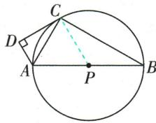

> [!success]- 必刷题
>
> > [!success] **【答案】** (1)【解】连接 CP, 如图. ∵ $\angle B = 30^{\circ}$ , ∴ $\angle APC = 2\angle B = 2 \times 30^{\circ} = 60^{\circ}$ . ∵ PC = PA, ∴ $\triangle ACP$ 是等边三角形, ∴ PA = AC = 2.  $$ \odot P $$ (2)
>
> > [!note]- **【解析】**
> > 【证明】∵ PC=PB, ∴ $\angle B=\angle PCB$ , ∴ $\angle APC=\angle PCB+\angle B=2\angle B$ . ∵ CD 是 $\odot P$ 的切线, ∴ $\angle DCP=90^{\circ}$ . ∵ $\angle ADC=90^{\circ}$ , ∴ $\angle ADC+\angle DCP=180^{\circ}$ , ∴ $AD\parallel PC$ , ∴ $\angle DAB+\angle APC=180^{\circ}$ , 即 $\angle DAB+2\angle B=180^{\circ}$ .
