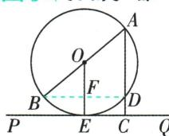
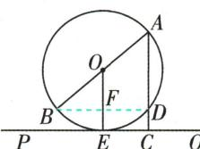

> [!success]- 必刷题
>
> > [!success] **【答案】** C
>
> > [!note]- **【解析】**
> > 
> > 【解析】连接 BD 交 OE 于 F 点, 如图. ∵ AB 是圆 O 的直径, ∴ $\angle ADB = 90^{\circ}$ . ∵ PQ 切圆 O 于点
> >
> > 
> >
> > $E, \therefore OE \perp PQ, \therefore \angle OEC = 90^{\circ}. \because AC \perp PQ$ 于点 $C, \therefore \angle ACE = 90^{\circ}, \therefore$ 四边形 CDFE 为矩形， $\therefore DF = CE = 4, \angle DFE = 90^{\circ}, \therefore OF \perp BD,$ $\therefore BF = DF = 4, \therefore BD = 8.$ 在 Rt△ABD 中， $AD = \sqrt{AB^{2} - BD^{2}} = \sqrt{10^{2} - 8^{2}} = 6.$
> >
> > 故选 **C**.
