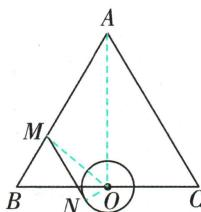

> [!success]- 必刷题
>
> > [!success] **【答案】** D
>
> > [!note]- **【解析】**
> > 如图, 连接 OA, OM, ON. ∵ 在边长为 4 的等边三角形 ABC 中, O 为线段 BC 的中点, ∴ $OB = \frac{1}{2} BC = 2$ , ∴ $AO = \sqrt{AB^{2} - OB^{2}} =$
> >
> > $2\sqrt{3}$ . ∵ MN 是 $\odot O$ 的切线，∴ $ON \perp MN$ . 根据勾股定理知 $MN^{2} = OM^{2} - ON^{2}$ . ∵ ON 为定值，∴ 当 OM 的值最小时，MN 的值最小，当 OM 的值最大时，MN 的值最大，∴ 当
> >
> > 
> >
> > $OM \perp AB$ 时, $MN$ 的值最小, 当 $M$ 与点 $A$ 重合时, $MN$ 的值最大. 当 $OM \perp AB$ 时, $\because S_{\triangle ABO} = \frac{1}{2} AO \cdot BO = \frac{1}{2} AB \cdot OM$ , $\therefore OM = \frac{OA \cdot OB}{AB} =$ $\sqrt{3}$ , $\therefore MN$ 的最小值为 $\sqrt{OM^{2}-ON^{2}}=\sqrt{2}$ , MN 的最大值为 $\sqrt{OM^{2}-ON^{2}}=\sqrt{11}$ , $\therefore \sqrt{2}\leqslant MN\leqslant\sqrt{11}$ , 选项 D 符合题意,
> >
> > 故选 **D**.
