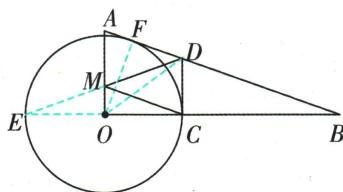
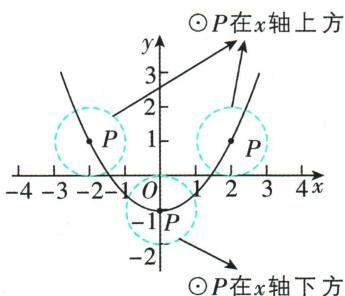

> [!success]- 必刷题
>
> > [!success] **【答案】** A
>
> > [!note]- **【解析】**
> > ∵ CD 为定长，∴ MC + MD 的值最小时，△MCD 周长最小. 如图，
> >
> > 
> >
> > 延长 $CO$ 交 $\odot O$ 于点 $E$ , 连接 $ED$ , 交 $AO$ 于点 $M$ , 则 $MC = ME$ , 此时 $MC + MD$ 的值最小, 为 $DE$ 的长. 设 $AB$ 与 $\odot O$ 相切于点 $F$ , 连接 $OF$ , 则 $\angle OFB = 90^{\circ}$ . $\because OC = 1$ , $\therefore OF = OC = 1$ , $\therefore BF = \sqrt{OB^{2} - OF^{2}} = \sqrt{3^{2} - 1^{2}} = 2\sqrt{2}$ . $\because CD \perp OB, OC$ 为 $\odot O$ 的半径, $\therefore CD$ 是 $\odot O$ 的切线. 连接 $OD$ , 利用 “HL” 易证 Rt $\triangle DOF \cong$ Rt $\triangle DOC$ , $\therefore DF = CD$ . $\because \angle DCB = 90^{\circ}$ , $\therefore CD^{2} + CB^{2} = BD^{2}$ , $\therefore CD^{2} + 2^{2} = (2\sqrt{2} - CD)^{2}$ , 解得 $CD = \frac{\sqrt{2}}{2}$ , $\therefore DE = \sqrt{CD^{2} + CE^{2}} = \sqrt{\left(\frac{\sqrt{2}}{2}\right)^{2} + 2^{2}} = \frac{3\sqrt{2}}{2}$ , $\therefore \triangle MCD$ 周长的最小值为 $DC + DM + MC = DC + DM + ME = DC + DE = \frac{\sqrt{2}}{2} + \frac{3\sqrt{2}}{2} = 2\sqrt{2}$ , 故选 A.
> >
> > 思路分析设点 $P$ 的坐标为 $(m, n)$ , 则 $n = \frac{1}{2} m^2 - 1$ , 由 $\odot P$ 与 $x$ 轴相切, 得 $n = 1$ 或 $n = -1$ , 则 $\frac{1}{2} m^2 - 1 = 1$ 或 $\frac{1}{2} m^2 - 1 = -1$ , 解方程求出 $m$ 的值即可.
> >
> > 
> >
> > 关键点拨
> > (2)①分⊙Q与AD边相切、与AB边相切、与CD边相切三种情况讨论.
> >
> > ## 思路分析
> >
> > 如图,延长 $CO$ 交 $\odot O$ 于点 $E$ , 连接 $ED$ , 交 $AO$ 于点 $M$ , 此时 $MC + MD$ 的值最小. 设 $AB$ 与 $\odot O$ 相切于 $F$ , 连接 $OF$ , 得到 $\angle OFB = 90^{\circ}$ , 根据勾股定理得到 $BF = \sqrt{OB^{2} - OF^{2}} = \sqrt{3^{2} - 1^{2}} = 2\sqrt{2}$ . 根据切线的性质及全等三角形的判定及性质得到 $DF = CD$ , 再根据勾股定理求得 $CD, DE$ 的长即可得出结论.
> >
> > 【解析】设点 P 的坐标为 $(m, n)$ . ∵ 点 P 在抛物线 $y = \frac{1}{2} x^{2} - 1$ 上, ∴ $n = \frac{1}{2} m^{2} - 1$ . ∵ ⊙P 的半径为 1, ∴ 当 ⊙P 与 x 轴相切时, n = 1 或 n = -1. 当 n = 1 时, 则 $\frac{1}{2} m^{2} - 1 = 1$ , 解得 $m_{1} = -2$ , $m_{2} = 2$ ; 当 n = -1 时, 则 $\frac{1}{2} m^{2} - 1 = -1$ , 则 m = 0, ∴ 点 P 的坐标为 $(-2, 1)$ 或 $(2, 1)$ 或 $(0, -1)$ , 故答案为 $(-2, 1)$ 或 $(2, 1)$ 或 $(0, -1)$ .
> >
> > ## 刷素养·
