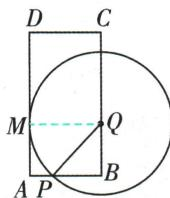
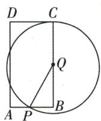
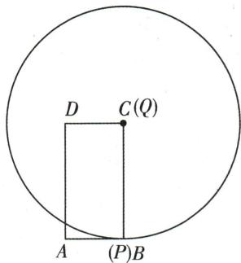
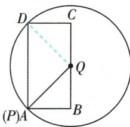

> [!success]- 必刷题
>
> > [!success] **【答案】** 详见解析
>
> > [!note]- **【解析】**
> > 【解】(1)当两点运动时间为t秒时,PA=t cm, BQ=2t cm.∵四边形ABCD是矩形,∴∠B=90°,∴PB=(6-t)cm,∴S△PBQ= $\frac{1}{2}$ PB·BQ= $\frac{1}{2}(6-t)\cdot2t=8$ ,解得t=4或2.∵12÷2=6(s),6÷1=6(s),∴0≤t≤6,∴t=4或2均符合题意.
> > 答:当t的值为2或4时,△PBQ的面积等于8 cm².
> >
> > (2)①存在. 由题意可知 $\odot O$ 与 $BC$ 边不相切. 当 $\odot Q$ 与 $AD$ 边相切时, 如图 (1), 设切点为 $M$ , 连接 $QM$ , $\therefore$ 四边形 $ABQM$ 为矩形, $\therefore Q M = A B = P Q = 6 \mathrm{~cm}$ , $\therefore$ 由勾股定理得
> >
> > 
> > 图(1)
> >
> > $6^{2}=(6-t)^{2}+(2t)^{2}$ ，解得 $t_{1}=0,t_{2}=\frac{12}{5}$ 。当t=0时，点P,Q分别与A,B重合，符合题意。当 $\odot Q$ 与DC边相切时，易知点C为切点，如图(2)所示。由题意可知 $BQ=2t\ cm,PB=(6-t)\ cm,PQ=CQ=(12-2t)\ cm.$ 在Rt△PQB中，由勾股定理可知 $PQ^{2}=PB^{2}+QB^{2}$ ，即 $(12-2t)^{2}=(6-t)^{2}+(2t)^{2}$ ，解得 $t_{1}=-18+12\sqrt{3},t_{2}=-18-12\sqrt{3}$ （舍去）。
> >
> > 
> >
> > 
> > 图(2)
> > 图(3)
> >
> > 如图(3)，当 $\odot Q$ 与 $AB$ 边相切时， $P, B$ 重合， $C, Q$ 重合，易得 $t = 6$ . 综上所述，当 $t = 0$ 或 $t = \frac{12}{5}$ 或 $t = -18 + 12\sqrt{3}$ 或 $t = 6$ 时， $\odot Q$ 与矩形
> >
> > ABCD 的一边相切.
> > - **②**：$\frac{12}{5}<t<6\sqrt{13}-18$ . 由①知, 当 t=0 时, $\odot Q$ 与矩形 ABCD 有 2 个公共点.
> > 当 $t=\frac{12}{5}$ 时, $\odot Q$ 与矩形 ABCD 有 3 个公共点.
> > 当 $\odot Q$ 与CD相切时, $\odot Q$ 与矩形ABCD有4个公共点.
> >
> > 如图(4)，当 $\odot Q$ 过点 $D$ 时， $\odot Q$ 与矩形ABCD有2个公共点，连接 $QD$ ，则 $PQ = DQ.$ 由题意可知 $PB = (6 - t)\mathrm{cm},BQ =$ $2t~\mathrm{cm},DC = 6~\mathrm{cm},CQ =$ $(12 - 2t)\mathrm{cm}$ ，由勾股定理
> >
> > 
> > 图(4)
> >
> > 可知 $DQ^{2}=DC^{2}+CQ^{2}=6^{2}+(12-2t)^{2}, PQ^{2}=PB^{2}+QB^{2}=(6-t)^{2}+(2t)^{2}.$ $\because DQ=PQ,$ $\therefore DQ^{2}=PQ^{2}$ ，即 $(6-t)^{2}+(2t)^{2}=6^{2}+(12-2t)^{2}$ 整理得 $t^{2}+36t-144=0$ ，解得 $t_{1}=6\sqrt{13}-18$ ， $t_{2}=-6\sqrt{13}-18$ （舍去），∴ 当 $\frac{12}{5}<t<6\sqrt{13}-18$ 时， $\odot Q$ 与矩形 ABCD 有 4 个公共点.
> >
> > ## 课时 3 切线长定理及三角形的内切圆
