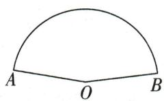
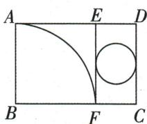

<!-- question-source:start -->
4[2024 湖北武汉江岸区校级质检]如图, 将扇形 OAB 纸片沿着半径剪成两个扇形, $\angle AOB = 164^{\circ}$ , 其中较小的扇形的圆心角为 $x^{\circ}$ , 围成一个圆锥甲(纸片不重合), 记它的底面积为 $S_{甲}$ ; 较大的扇形的圆心角为 $y^{\circ}$ , 围成一个圆锥乙(纸片不重合), 记它的底面积为 $S_{乙}$ . 若 $S_{乙} = 9S_{甲}$ , 则 x 的值为 ( )
A. 41 B. 45 C. 36 D. 40

(第 4 题图)

(第5题图)
<!-- question-source:end -->

![[Q00106975A1]]
