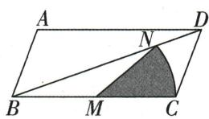
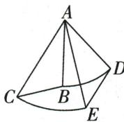

<!-- question-source:start -->
6[2025 内蒙古呼和浩特中]如图是平行四边形纸片 $ABCD, BC = 36 \mathrm{~cm}, \angle A = 110^{\circ}, \angle BDC = 50^{\circ}$ , 点 $M$ 为 $BC$ 的中点, 若以 $M$ 为圆心, $MC$ 为半径画弧交对角线 $BD$ 于点 $N$ , 则 $\angle NMC =$ \_\_\_\_°; 将扇形 $MCN$ 纸片剪下来围成一个无底的圆锥 (无重叠且无缝隙), 则这个圆锥的底面半径为 \_\_\_\_ cm.

(第6题图)
(第7题图)
<!-- question-source:end -->

![[Q00106977A1]]
