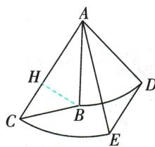

> [!success]- 必刷题
>
> > [!success] **【答案】** $\sqrt{3} - 1$
>
> > [!note]- **【解析】**
> > 过 $B$ 点作 $BH \perp AC$ 于 $H$ , 如图. 在 Rt $\triangle ABH$ 中, $\because \angle CAB = 30^{\circ}$ , $AB = 2$ , $\therefore BH = \frac{1}{2}AB = \frac{1}{2} \times 2 = 1$ , $\therefore AH =$
> >
> > 
> >
> > $\sqrt{AB^2 - BH^2} = \sqrt{3}$ . 在 Rt $\triangle BCH$ 中, $\because \angle ACB =$
> >
> > $45^{\circ}, \therefore CH = BH = 1, \therefore AC = AH + CH = \sqrt{3} + 1.$ $\because \triangle ABC$ 绕点 $A$ 逆时针旋转一定的角度至 $\triangle ADE, \therefore \angle CAE = \angle BAD.$ 设 $\angle CAE = \angle BAD = n^{\circ}, \therefore 2\pi r_{1} = \frac{n \times \pi \times 2}{180}, 2\pi r_{2} = \frac{n \times \pi \times (\sqrt{3} + 1)}{180},$ $\therefore r_{1} = \frac{n}{180}, r_{2} = \frac{n(\sqrt{3} + 1)}{360}, \therefore \frac{r_{1}}{r_{2}} = \frac{2}{\sqrt{3} + 1} = \sqrt{3} - 1.$ 故答案为 $\sqrt{3} - 1$ .
> >
> > ## 刷易错·
