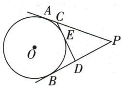
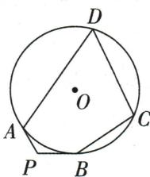

<!-- question-source:start -->
1 如图, P 为 $\odot O$ 外一点, PA, PB 分别切 $\odot O$ 于点 A, B, CD 切 $\odot O$ 于点 E, 分别交 PA, PB 于点 C, D. 若 PA = 8, 则 $\triangle PCD$ 的周长为 ( )
A. 8    B. 12    C. 16    D. 20

(第1题图)
(第2题图)
<!-- question-source:end -->

![[Q00106914A1]]
