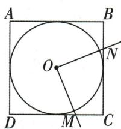

<!-- question-source:start -->
3 如图, $\odot O$ 内切于正方形 $ABCD, O$ 为圆心, 作 $\angle MON = 90^{\circ}$ , 其两边分别交 $BC, CD$ 于点 $N, M$ , 若 $CM + CN = 4$ , 则 $\odot O$ 的面积为 \_\_\_\_.

<!-- question-source:end -->

![[Q00106916A1]]
