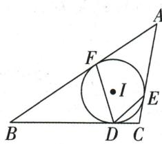
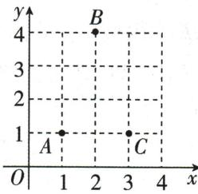

<!-- question-source:start -->
5[2025 广东广州期末]如图, $\triangle ABC$ 的内切圆 $\odot I$ 与 $BC, CA, AB$ 分别相切于点 $D, E, F$ , 若 $\odot I$ 的半径为 $r$ , $\angle FDE = \alpha$ , 则 $AF + CD - AC$ 的值和 $\angle A$ 的度数分别为 ( )
A. $0, 180^{\circ} - 2\alpha$ B. $r, 180^{\circ} - \alpha$ C. $\sqrt{2} r, 90^{\circ} - \alpha$ D. $\sqrt{3} r, 90^{\circ} - \frac{\alpha}{2}$

(第 5 题图)

(第6题图)
<!-- question-source:end -->

![[Q00106918A1]]
