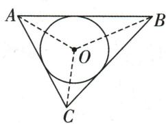
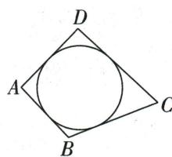

<!-- question-source:start -->
7[2024 河北沧州校级期末]阅读材料:如图(1), $\triangle ABC$ 的周长为 l, 面积为 S, 内切圆 $\odot O$ 的半径为 r, 探究 r 与 S, l 之间的关系.

解:如图(1), 连接 OA, OB, OC. $\because S_{\triangle AOB} = \frac{1}{2} AB \cdot r, S_{\triangle OBC} = \frac{1}{2} BC \cdot r, S_{\triangle OCA} = \frac{1}{2} CA \cdot r,$ $\therefore S=\frac{1}{2}AB\cdot r+\frac{1}{2}BC\cdot r+\frac{1}{2}CA\cdot r=\frac{1}{2}l\cdot r,$ $\therefore r=\frac{2S}{l}.$

解决问题：

(1) 利用探究的结论, 计算边长分别为 5, 12, 13 的三角形内切圆半径.

(2)如图(2),若四边形ABCD存在内切圆(与各边都相切的圆),且面积为S,各边长分别为a,b,c,d,试推导四边形的内切圆半径公式.

(3) 若一个 n 边形 (n 为不小于 3 的整数) 存在内切圆, 且面积为 S, 各边长分别为 $a_{1}, a_{2}, a_{3}, a_{4}, \cdots, a_{n}$ , 猜想其内切圆半径公式 (不需说明理由).

图(1)

图(2)
<!-- question-source:end -->

![[Q00106920A1]]
