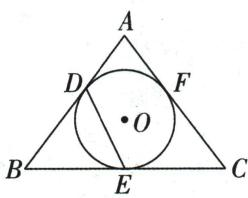
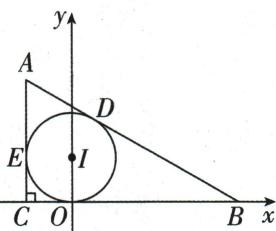

<!-- question-source:start -->
1[2024 四川泸州期中, 中]如图, 等腰 $\triangle ABC$ 的内切圆 $\odot O$ 与 AB, BC, CA 分别相切于点 D, E, F, 且 AB = AC = 5, BC = 6, 则 DE 的长是 ( )
A. $\frac{3\sqrt{10}}{10}$ B. $\frac{3\sqrt{10}}{5}$ C. $\frac{3\sqrt{5}}{5}$ D. $\frac{6\sqrt{5}}{5}$

(第1题图)

(第2题图)
<!-- question-source:end -->

![[Q00106921A1]]
