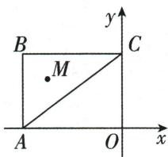

<!-- question-source:start -->
3[2024 辽宁鞍山期中, 中]如图, 矩形 OABC 在平面直角坐标系中, 其中 B(-4,3), 点 M 为 $\triangle ABC$ 的内心, 将矩形绕点 C 顺时针旋转 $90^{\circ}$ , 则点 M 的对应点坐标为 \_\_\_\_.

<!-- question-source:end -->

![[Q00106923A1]]
