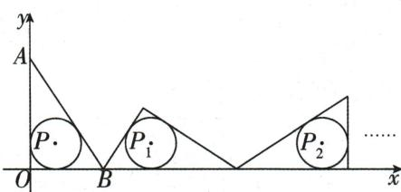

<!-- question-source:start -->
4[较难]如图,把 Rt△OAB 置于平面直角坐标系中,点 A 的坐标为(0,4),点 B 的坐标为(3,0),点 P 是 Rt△OAB 内切圆的圆心.将 Rt△OAB 沿 x 轴的正方向作无滑动滚动,使它的三边依次与 x 轴重合,第一次滚动后圆心为 $P_{1}$ ,第二次滚动后圆心为 $P_{2},\cdots$ ,以此规律,第 2022 次滚动后,Rt△OAB 内切圆的圆心 $P_{2022}$ 的坐标是 \_\_\_\_.

<!-- question-source:end -->

![[Q00106924A1]]
