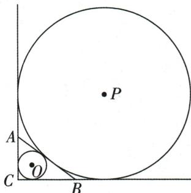
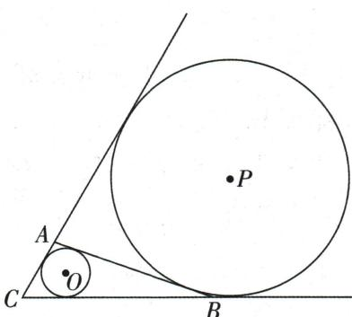

<!-- question-source:start -->
5 思想方法 数形结合 [2025 山东淄博期末, 较难] 在 $\triangle ABC$ 中, $\angle C = \alpha$ , 设 $BC = a, AC = b, AB = c$ . $\odot O$ 是 $\triangle ABC$ 的内切圆, $\odot P$ 与 $CA$ 的延长线、 $CB$ 的延长线以及直线 $AB$ 分别只有一个公共点, $\odot O$ 的半径为 $m$ , $\odot P$ 的半径为 $n$ .

(1) 当 $\alpha = 90^{\circ}, b = 6, a = 8$ 时, $m = \_\_\_\_,$ $n = \_\_\_\_.$

(2)如图(1),若 $\alpha = 90^{\circ}$ ,则 $m = \_\_\_\_, n = \_\_\_\_($ (用含有 $a, b, c$ 的代数式表示); $\triangle ABC$ 的面积为 \_\_\_\_(用含 $m, n$ 的代数式表示). (3)如图(2), $\alpha = 60^{\circ}$ ,求 $\triangle ABC$ 的面积(用含 $m, n$ 的代数式表示).

图(1)

图(2)
<!-- question-source:end -->

![[Q00106925A1]]
