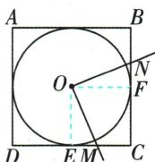

> [!success]- 必刷题
>
> > [!success] **【答案】** 4π
>
> > [!note]- **【解析】**
> > 如图, 设 $\odot O$ 与正方形 ABCD 的边 CD 切于 E, 与 BC 切于 F, 连接 OE, OF, $\therefore CF = CE = OE = OF$ , $\angle OEM = \angle OFN = \angle EOF =$
> >
> > 
> >
> > 从圆外一点引圆的两条切线, 它们的切线长相等.
> >
> > $90^{\circ}$ $\because \angle MON = 90^{\circ},\therefore \angle EOM = \angle FON,$ $\therefore \triangle OEM\cong \triangle OFN(ASA),\therefore EM = NF,$ $\therefore CM + CN = CE + CF = 2CF = 4,\therefore OE = CF = 2,$ $\therefore \odot O$ 的面积为 $4\pi$
