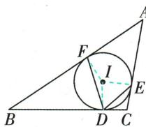

> [!success]- 必刷题
>
> > [!success] **【答案】** A
>
> > [!note]- **【解析】**
> > 连接 $IE, IF, ID$ , 如图. $\because \triangle ABC$
> >
> > 内切圆 $\odot I$ 与 $BC, CA, AB$ 分别相切于点 $D, E, F,$ $\angle FDE = \alpha, \therefore AF = AE,$ $CD = CE, AB \perp IF, AC \perp IE,$ $\therefore AF + CD = AE + CE = AC,$
> >
> > 
> >
> > $\therefore AF + CD - AC = AC - AC = 0.\because \angle AEI = \angle AFI = 90^{\circ},\angle FIE = 2\angle FDE = 2\alpha ,\therefore \angle A = 360^{\circ} - \angle AEI - \angle AFI - \angle FIE = 360^{\circ} - 90^{\circ} - 90^{\circ} - 2\alpha = 180^{\circ} - 2\alpha .$
> >
> > 故选 **A**.
