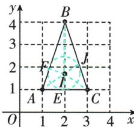

> [!success]- 必刷题
>
> > [!success] **【答案】** $\frac{\sqrt{10} - 1}{3}$
>
> > [!note]- **【解析】**
> > 设 $\triangle ABC$ 的内切圆 $\odot I$ 与 $\overline{AB, BC}, AC$ 分别相切于点 $F, J, E$ , 连接 $IF, IJ$ ,
> >
> > IE, 如图. $\because A(1,1)$ , $B(2,4), C(3,1), \therefore AC=3-1=2, AB=BC= \sqrt{1^{2}+3^{2}}=\sqrt{10}, \therefore S_{\triangle ABC}=\frac{1}{2}\times2\times3=3.$ 连接 AI, BI,
> >
> > 
> >
> > CI, 设 $\triangle ABC$ 的内切圆 $\odot I$ 的半径长为 r，则 IF = IJ = IE = r. ∵ IF ⊥ AB 于点 F, IJ ⊥ BC 于点 J, IE ⊥ AC 于点 E, ∴ $S_{\triangle ABC} = S_{\triangle AIB} + S_{\triangle BIC} + S_{\triangle AIC} = \frac{1}{2} AB \cdot IF + \frac{1}{2} BC \cdot IJ + \frac{1}{2} AC \cdot IE$ , ∴ $\frac{1}{2} \times \sqrt{10} r + \frac{1}{2} \times \sqrt{10} r + \frac{1}{2} \times 2r = 3$ , 解得 $r = \frac{\sqrt{10} - 1}{3}$ . 故答案为 $\frac{\sqrt{10} - 1}{3}$ .
