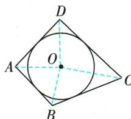

> [!success]- 必刷题
>
> > [!success] **【答案】** 详见解析
>
> > [!note]- **【解析】**
> > 【解】(1) $\because5^{2}+12^{2}=13^{2},\therefore$ 此三角形为直角三角形, $\therefore$ 三角形面积 $S=\frac{1}{2}\times5\times12=30,\therefore$ 三角形内切圆半径为 $\frac{2\times30}{5+12+13}=2.$
> >
> > (2) 设四边形 ABCD 内切圆的圆心为 O，连接 OA，OB, OC, OD，如图，
> > 则 $S = S_{\triangle OAB} + S_{\triangle OBC} + S_{\triangle OCD} +$ $S_{\triangle ODA}=\frac{1}{2}AB\cdot r+\frac{1}{2}BC\cdot$
> >
> > 
> >
> > $r + \frac{1}{2} CD\cdot r + \frac{1}{2} DA\cdot r = \frac{1}{2} (a + b + c + d)\cdot r,$ $\therefore r = \frac{2S}{a + b + c + d}$
> >
> > (3)类比(1)(2)的结论,易得 n 边形内切圆半径公式为 $r=\frac{2S}{a_{1}+a_{2}+\cdots+a_{n}}$ .
