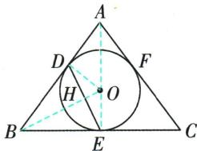

> [!success]- 必刷题
>
> > [!success] **【答案】** D
>
> > [!note]- **【解析】**
> > 连接 OA, OE, OD, OB, OB 交 DE 于 H, 如图. ∵ 等腰 $\triangle ABC$ 的内切圆 $\odot O$ 与 AB, BC, CA 分别相切于
> >
> > 
> >
> > 点 $D, E, F, \therefore AO$ 平分 $\angle BAC, OE \perp BC, OD \perp AB, BE = BD$ . $\because AB = AC, \therefore$ 点 $A, O, E$ 共线，即 $AE \perp BC, \therefore BE = CE = 3$ . 在 Rt $\triangle ABE$ 中， $AE = \sqrt{5^2 - 3^2} = 4$ . $\because BD = BE = 3, \therefore AD = 2$ . 设 $\odot O$ 的半径为 $r$ ，则 $OD = OE = r, AO = 4 - r$ . 在 Rt $\triangle AOD$ 中， $r^2 + 2^2 = (4 - r)^2$ ，解得 $r = \frac{3}{2}$ . 在 Rt $\triangle BOE$ 中， $OB = \sqrt{BE^2 + OE^2} = \sqrt{3^2 + \left(\frac{3}{2}\right)^2} = \frac{3\sqrt{5}}{2}$ . $\because BE = BD, OE = OD, \therefore OB$ 垂直平分 $DE, \therefore DH = EH, OB \perp DE$ . $\because S_{\triangle OBE} = \frac{1}{2} HE \cdot OB = \frac{1}{2} OE \cdot BE, \therefore HE = \frac{OE \cdot BE}{OB} = \frac{3 \times \frac{3}{2}}{\frac{3\sqrt{5}}{2}} = \frac{3\sqrt{5}}{5}, \therefore DE = 2EH = \frac{6\sqrt{5}}{5}$ ,
> >
> > 故选 **D**.
