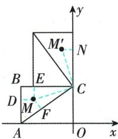

> [!success]- 必刷题
>
> > [!success] **【答案】** $(-1,6)$
>
> > [!note]- **【解析】**
> > 如图，过点 M 作 $MD \perp AB, ME \perp BC, MF \perp AC$ ，垂足分别为 D, E, F，则 $\angle MDB = \angle MEB = \angle B = 90^{\circ}$ ，∴ 四边形 BDME 是矩形。∵ 点 M 为 $\triangle ABC$ 的内心，∴ MD = ME = MF，∴的内心, $\therefore MD=ME=MF,\therefore$ 四边形 BDME 是
> >
> > 
> >
> > 思路分析
> > 由勾股定理得出 AB = 5，得出 Rt $\triangle OAB$ 内切圆的半径为 1，因此 P 的坐标为 (1, 1). 由题意得出 $P_{3}$ 的坐标为 $(3 + 5 + 4 + 1, 1)$ ，得出每滚动 3 次为一个循环，由 $2022 \div 3 = 674$ ，根据规律，即可得出答案.
> >
> > ## 另解
> >
> > 根据点 M 为 $\triangle ABC$ 的内心, 可得点 M 为 $\triangle ABC$ 角平分线的交点, 过点 M 分别作 $\triangle ABC$ 三边的高线 DM, EM, FM, 垂足分别为 D, E, F, 则 DM = EM = FM. 连接 BM, CM, AM, 设 DM = EM = FM = R, 根据 $S_{\triangle ABM} + S_{\triangle BCM} + S_{\triangle ACM} = S_{\triangle ABC}$ , 列式求出 R 的值, 进而可以解决问题.
> >
> > 正方形. 在矩形 OABC 中, $B(-4,3)$ , ∴ AB = 3, BC = 4, $\angle B = 90^{\circ}$ , ∴ AC = 5. 设 BD = x, 则 BE = BD = x, AD = AF = 3 - x, CF = CE = 4 - x, ∴ 3 - x + 4 - x = 5, 解得 x = 1, ∴ M (-3, 2). 设将矩形绕点 C 顺时针旋转 $90^{\circ}$ 后, 点 M 的对应点为点 $M'$ , 如图, 连接 MC, $M'C$ , 过点 $M'$ 作 $M'N \perp y$ 轴于点 N, ∴ $\angle MCE + \angle M'CE = \angle M'CE + \angle M'CN = 90^{\circ}$ , ∴ $\angle MCE = \angle M'CN$ . 又∵ $\angle MEC = \angle M'NC = 90^{\circ}$ , MC = $M'C$ , ∴ $\triangle MCE \cong \triangle M'CN$ (AAS), ∴ CN = CE = 3, $M'N = ME = 1$ , ∴ 点 $M'$ 的坐标为 (-1, 6).
