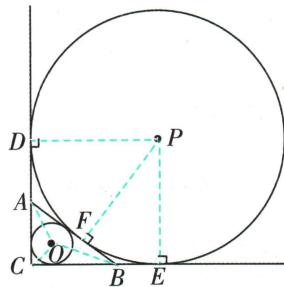
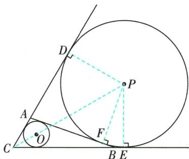

> [!success]- 必刷题
>
> > [!success] **【答案】** 2,12
>
> > [!note]- **【解析】**
> > 【解】(1) $\because\alpha=90^{\circ},b=6,a=8,\therefore c=\sqrt{a^{2}+b^{2}}=$ 10. 由题意得, $\odot P$ 分别与 CA 的延长线、CB 的延长线以及直线 AB 相切, 设切点分别为
> >
> > D, E, F, 连接 PD,
> > PE, PF, OA, OB,
> > OC, 如图(1).∵ ⊙O
> > 是△ABC 的内切圆，
> > ∴ 易得 $S_{\triangle BCA} = S_{\triangle ABO} + S_{\triangle ACO} + S_{\triangle BCO}$ ,
> > ∴ $\frac{1}{2} \times 6 \times 8 = \frac{1}{2} \times$
> >
> > 
> > 图(1)
> >
> > $10m+\frac{1}{2}\times6m+\frac{1}{2}\times8m,\therefore m=2.$ 由题易得,四边形 DPEC 为正方形, $\therefore n=PD=\frac{1}{2}(CD+CE)$ . 由切线长定理可知,AF=AD,BF=BE, $\therefore n=\frac{1}{2}(CD+CE)=\frac{1}{2}(AD+AC+BE+BC)=\frac{1}{2}(AB+AC+BC)=\frac{1}{2}(10+6+8)=12.$ 故答案为2,12.
> >
> > (2) 同(1) 可知 $\frac{1}{2}ab = \frac{1}{2}(am + bm + cm)$ , $\therefore m = \frac{ab}{a + b + c}$ . 由(1) 可得 $n = \frac{1}{2}(AB + AC + BC) = \frac{a + b + c}{2}$ , $\therefore a + b + c = 2n$ , $\therefore S_{\triangle ABC} = \frac{1}{2}AC \cdot m + \frac{1}{2}BC \cdot m + \frac{1}{2}AB \cdot m = \frac{m}{2}(AB + AC + BC) = \frac{m}{2}(a + b + c) = mn$ . 故答案为 $\frac{ab}{a + b + c}, \frac{a + b + c}{2}, mn$ .
> >
> > (3)如图(2)，连接 $CP$ ，设 $\odot P$ 与 $CA$ 延长线、 $CB$ 延长线， $AB$ 的切点分别为 $D, E, F$ ，连接 $PD, PE, PF$ . 由切线长定理得 $AD = AF, BE = BF, CD = CE, \therefore CD = CE = \frac{1}{2}(CD + CE) = \frac{1}{2}(AD + AC + BE + BC) = \frac{1}{2}(AB + AC + BC) = \frac{1}{2}(a + b + c)$ . $\because PD \perp CD, PE \perp BC, PD = PE, \therefore CP$ 平分 $\angle ACB, \therefore \angle PCE = 30^\circ, \therefore PC = 2PE = 2n, \therefore$ 由勾股定理得 $CE = \sqrt{3} n, \therefore n = \frac{CE}{\sqrt{3}} = \frac{a + b + c}{2\sqrt{3}}, \therefore a + b + c = 2\sqrt{3} n.$ 同(2)得 $m = \frac{ab}{a + b + c}, \therefore S_{\triangle ABC} = \frac{m}{2}(a + b + c) = \frac{1}{2} m \cdot 2\sqrt{3} n = \sqrt{3} mn.$
> >
> > 
> > 图(2)
