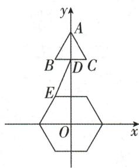

<!-- question-source:start -->
1[2025 江苏常州质检, 中]如图, 已知边长为 2

的等边 $\triangle ABC$ 顶点 $A$ 的坐标为(0,6), $BC$ 的中点 $D$ 在 $y$ 轴上, 且在点 $A$ 下方, 点 $E$ 是边长为2、中心在原点 $O$ 处的正六边形的一个顶点, 把这个正六边形绕中心旋

转一周,在此过程中 DE 的最小值为 ( )
A. 3    B. $4-\sqrt{3}$ C. 4    D. $6-2\sqrt{3}$
<!-- question-source:end -->

![[Q00106986A1]]
