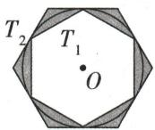
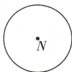

<!-- question-source:start -->
2[2024 山东东营校级质检, 中]如图(1), 有一个圆 O 和正六边形 $T_{1}$ 、正六边形 $T_{2}$ . 正六边形 $T_{1}$ 的六个顶点都在圆上, 正六边形 $T_{2}$ 的六条边都和圆 O 相切 (我们称正六边形 $T_{1}$ 、正六边形 $T_{2}$ 分别为圆 O 的内接正六边形和外切正六边形), 设圆 O 的半径为 R.

(1) 请你在图(2)中画出圆 N 的内接正六边形, 并简要写出作法;

(2) 求图(1)中正六边形 $T_{1}$ 、正六边形 $T_{2}$ 的边长 (用含 R 的式子表示);

(3) 求图(1)中阴影部分的面积 (用含 R 的式子表示).

图(1)

图(2)

建议用时 40 分钟 答案 D72
<!-- question-source:end -->

![[Q00106987A1]]
